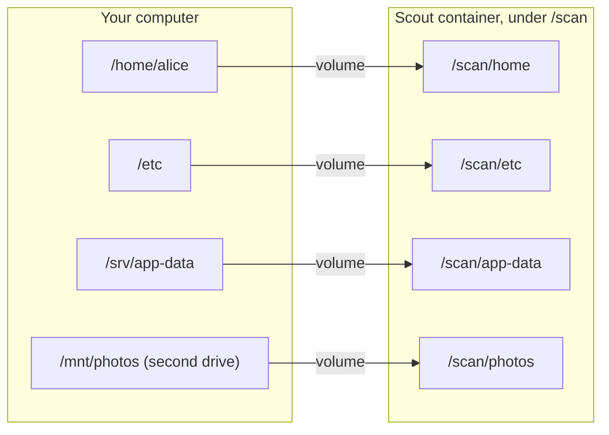

Scout can only see folders that Docker mounts beneath `/scan` inside the container. To back up more than one location, add one volume entry per folder. Your files stay where they are on your computer, including on other drives.

The folders don't need to be related. One Scout can back up your home folder, system settings in `/etc`, an app's data folder, and a second drive side by side.

Each entry has the form:

```text
"folder on your computer:folder inside Scout"
```

For example, `"/etc:/scan/etc"` makes `/etc` appear as `/scan/etc` in Scout. On Windows, use forward slashes in Compose, such as `"C:/ProgramData/MyApp:/scan/app-data"`.



## Set it up

<Steps>
  <Step title="Open docker-compose.yml">
    Find the `volumes:` section under the `scout` service.
  </Step>
  <Step title="Replace the single-folder entry">
    Remove this line:

    ```yaml
          - ${SCAN_DIR:-./scan}:/scan
    ```

    and add one entry per folder in its place. Give each a different name under `/scan`:

    <Tabs>
      <Tab title="Linux">
        ```yaml docker-compose.yml
            volumes:
              - ./config:/config
              - ./hook-scripts:/hook-scripts
              - "/home/alice:/scan/home"
              - "/etc:/scan/etc"
              - "/srv/app-data:/scan/app-data"
              - ./state:/data/state
              - ./spool:/data/spool
        ```
      </Tab>
      <Tab title="Windows">
        ```yaml docker-compose.yml
            volumes:
              - ./config:/config
              - ./hook-scripts:/hook-scripts
              - "C:/Users/Alice:/scan/home"
              - "C:/ProgramData/MyApp:/scan/app-data"
              - "D:/Projects:/scan/projects"
              - ./state:/data/state
              - ./spool:/data/spool
        ```
      </Tab>
    </Tabs>

    Keep the other volume entries unchanged.
  </Step>
  <Step title="Update .env">
    Remove `SCAN_DIR` from `.env`, since the entries above now name the folders directly. If you set `SCAN_ROOT`, keep it at `/scan`.
  </Step>
  <Step title="Recreate the container">
    From the folder with the Compose file:

    ```sh
    docker compose up -d --force-recreate scout
    ```
  </Step>
  <Step title="Choose what to back up">
    Refresh Scout's UI. The folder browser shows one folder under `/scan` per entry, for example:

    ```text
    /scan
      app-data   (/srv/app-data on your computer)
      etc        (/etc on your computer)
      home       (/home/alice on your computer)
    ```

    Create jobs for the folders you want. See [Backup jobs](/scout/backup-jobs).
  </Step>
</Steps>

<Warning>
  Don't make `/scan` itself a job. It would become one combined job covering every mounted folder.
</Warning>

## Add another drive later

Add another line to the same `volumes` section, recreate the container, refresh Scout, and create a job for the new folder:

<Tabs>
  <Tab title="Linux">
    ```yaml
          - "/mnt/photos:/scan/photos"
    ```
  </Tab>
  <Tab title="Windows">
    ```yaml
          - "E:/Photos:/scan/photos"
    ```
  </Tab>
</Tabs>

Adding a volume only makes a folder **visible**. It isn't backed up until you create a job for it.

## Back up whole drives

You can mount a whole drive instead of one folder on it. Give each drive its own name under `/scan`:

<Tabs>
  <Tab title="Linux">
    Mount `/home` and `/etc` alongside each additional drive's mount point:

    ```yaml
          - "/home:/scan/home"
          - "/etc:/scan/etc"
          - "/mnt/data:/scan/data"
          - "/mnt/media:/scan/media"
    ```

    Docker includes drives mounted inside a mounted folder. If `/mnt/data` is inside `/`, mounting `/` already shows it at `/scan/root/mnt/data`. Mounting it separately as well shows the same folders twice, so a job there would appear twice with the same name. Mount each drive in one place only: either mount `/` alone, or mount the folders you need from it, such as `/home` and `/etc`, next to your other drives.
  </Tab>
  <Tab title="Windows">
    Mount each drive letter:

    ```yaml
          - "C:/:/scan/c"
          - "D:/:/scan/d"
          - "E:/:/scan/e"
    ```
  </Tab>
</Tabs>

Then create jobs for the folders you want on each drive.

<Warning>
  Don't make a whole drive, such as `/scan/data` or `/scan/c`, a job. On a system drive, that would also back up the operating system, installed programs, and swap or page files. Choose the folders you need instead.
</Warning>

### Switching from one drive mounted as `/scan`

If `SCAN_DIR` points at a whole drive today, check how the new mounts change your folder paths. On Linux, `/scan/home/alice` stays at the same path with `/home:/scan/home`. On Windows, `/scan/Users/Alice` becomes `/scan/c/Users/Alice`.

- **Existing jobs in mounted folders keep working.** Their settings are stored in the folders, so Scout finds them through the new mounts. Folders outside those mounts are no longer visible.
- **Job names stay the same,** so each job's history on Station continues. If a job's path changes, the next cycle may upload it again, because Scout tracks local state by path.
- **Check Max Depth.** Raise it by 1 if the new mount adds a path level so deep jobs are still found.

## Things to know

- **Job names must be unique across all mounted folders.** The mount names, such as `home` and `etc`, don't separate same-named jobs on Station. If two folders would both be called `config`, name the jobs `home-config` and `etc-config`.
- **Mounts need write access** for Scout to save markers and restore files. Scout writes its `.upload_dir` marker into each job's folder, including system folders such as `/etc`.
- **Scout runs as root inside the container,** so it can read root-only files such as those in `/etc`.
- **Max Depth counts the extra level.** The `/scan/<name>` folders add one level, so raise **Max Depth** in settings if your markers are deep.
- **Moving an existing folder under a new mount?** Keep its job name so its history on Station continues. Scout tracks local state by path, so the next cycle may upload it again.
- **Docker Desktop must share the folder.** If it reports that a folder is "not shared from the host", add it under **Settings > Resources > File sharing**.

The same steps work with the build-from-source Compose file in `app/scout/`.
