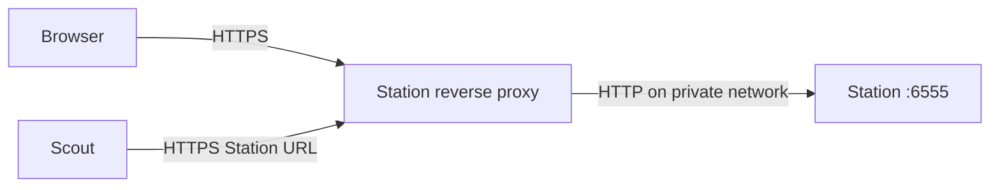

Scout and Station can be reached at HTTPS hostnames or IP addresses. Each app serves HTTP itself; a reverse proxy handles HTTPS and forwards requests to the app. Uploading a certificate under **Trusted Certificates** changes which HTTPS services the app trusts, but does not turn on HTTPS for its web UI.

This guide uses certificates you already have. All hostnames, IP addresses, and paths below are examples; replace them with your own.

## How the connections fit together



Scout's web UI has its own equivalent path: browser → HTTPS reverse proxy → HTTP Scout on port `6556`. Using HTTPS for Scout's UI does not change Scout's connection to Station; set its **Station URL** separately.

HTTPS ends at the proxy. Keep the proxy-to-app connection on the same host or a network you trust, and restrict direct access to the app's HTTP port. If that connection must cross an untrusted network, protect it with an encrypted tunnel or another operator-managed transport.

### Three different certificate files

| File | Where it belongs | Purpose |
|---|---|---|
| Server certificate, usually with its intermediate chain | Reverse proxy | Identifies the HTTPS hostname or IP address. |
| Server's private key | Reverse proxy | Lets the proxy prove that identity. Keep it private. |
| CA/root certificate, as a PEM `.crt` file | Each client that needs to trust the private CA | Lets Scout, an integration client, or your browser verify certificates issued by that CA. |

The CA's private key stays with your certificate authority. Do not upload private keys to **Trusted Certificates**. The TLS private key is also separate from your **Scout key** and **Station token**.

## 1. Choose an address and certificate

| Address you open | Certificate requirement | Trust setup |
|---|---|---|
| `https://station.example.com` with a publicly trusted certificate | A DNS Subject Alternative Name covering `station.example.com` | Normally no CA upload or browser changes. |
| `https://station.home.example.com` with your homelab CA | A DNS Subject Alternative Name covering that hostname | Trust the homelab root CA in Scout and in the devices/browsers you use. |
| `https://192.168.1.10` | An **IP** Subject Alternative Name containing `192.168.1.10` | For a private LAN IP, use a private CA and configure client trust. |

The URL must match a certificate's **Subject Alternative Names (SANs)**. A certificate for a hostname does not also cover the IP that hostname resolves to. Putting an IP in a DNS SAN is not sufficient, and a legacy Common Name alone is not sufficient. A certificate can contain both DNS and IP SANs. A wildcard such as `*.example.com` covers `station.example.com`, but not `station.home.example.com`. See [Go's hostname verification rules](https://pkg.go.dev/crypto/x509#Certificate.VerifyHostname).

Publicly trusted CAs do not issue certificates for private addresses such as `192.168.1.10` or internal-only names such as `station.lan`; see the [CA/Browser Forum requirements](https://cabforum.org/working-groups/server/baseline-requirements/requirements/#422-approval-or-rejection-of-certificate-applications). A private CA can issue certificates for those addresses.

A publicly trusted certificate can still be used for a service that stays inside your LAN: use a domain you own, resolve it to the proxy's private IP in your local DNS, and obtain the certificate through DNS validation. [Let's Encrypt's DNS-01 challenge](https://letsencrypt.org/docs/challenge-types/#dns-01-challenge) supports services that are not exposed to the public internet. Certificate issuance and renewal remain the responsibility of your proxy or certificate tooling.

For hostnames, make sure DNS resolves to the proxy from both your browser's device and the Scout container. A hosts-file entry on your laptop does not configure DNS inside Scout. Use a complete IP address such as `192.168.1.10`, not just `192.168`.

## 2. Configure your reverse proxy

If your homelab already has a proxy, add an HTTPS site for each app:

| HTTPS site | HTTP upstream |
|---|---|
| `https://station.example.com` | Station's reachable address on port `6555` |
| `https://scout.example.com` | That Scout's reachable address on port `6556` |

Install the site's server certificate, intermediate chain, and matching private key in the proxy. A missing intermediate can cause trust failures even when the root CA is trusted.

Forward the whole site, including `/api/` and `/static/`, and preserve the original **Host** header, cookies, and **Authorization** header. Serve each app at its own hostname or HTTPS port, at the root path `/`. The apps do not provide a configurable base path for deployments such as `/station/` and `/scout/`.

Inside a proxy container, `localhost` means that proxy container. Use the app's service name on a shared Docker network, or an address the proxy can actually reach. If the proxy is on a different host, allow its connection to the app's HTTP port while restricting other direct access.

### Example: Caddy with your existing certificates

This example adds Caddy to the existing **Station** Compose project. If ports `80` or `443` already belong to your homelab proxy, configure that proxy instead.

Create these folders beside Station's `docker-compose.yml`:

```text
3to1go-station/
├── docker-compose.yml
├── .env
└── https/
    ├── caddy/
    │   └── Caddyfile
    └── certs/
        ├── station-fullchain.pem
        └── station-key.pem
```

Put your server certificate and intermediate chain in `station-fullchain.pem`, and its matching private key in `station-key.pem`. Keep the certificate folder out of source control and limit access to the private key.

Add the `caddy` service and named volumes to your existing Compose file, alongside its current services and volumes:

```yaml docker-compose.yml
services:
  caddy:
    image: caddy:2
    restart: unless-stopped
    ports:
      - "80:80"
      - "443:443"
    volumes:
      - ./https/caddy:/etc/caddy:ro
      - ./https/certs:/certs:ro
      - caddy_data:/data
      - caddy_config:/config

volumes:
  caddy_data:
  caddy_config:
```

This is an addition to your existing file, not a replacement for the Station or PostgreSQL services. Both Caddy and Station use the Compose project's default network. The example uses the Caddy 2 image; pin a suitable release for your deployment. See [Caddy's Docker Compose guide](https://caddyserver.com/docs/running#docker-compose).

Create `https/caddy/Caddyfile`:

```text Caddyfile
https://station.example.com {
    tls /certs/station-fullchain.pem /certs/station-key.pem
    reverse_proxy http://station:6555 {
        transport http {
            keepalive 25s
        }
    }
}
```

The `tls` directive loads your existing certificate and key; see [Caddy's TLS reference](https://caddyserver.com/docs/caddyfile/directives/tls). The HTTP upstream preserves the request host by default. The short upstream keepalive avoids reusing a connection after the app closes it; see [Caddy's proxy reference](https://caddyserver.com/docs/caddyfile/directives/reverse_proxy#the-http-transport).

Remove Station's `ports: ["6555:6555"]` mapping, or the equivalent multiline entry, from its service. Caddy can reach `station:6555` on the Docker network without that host port. Keep Station's existing environment, database, and volume configuration, and leave its in-container `HTTP_HOST` at `0.0.0.0`.

Validate the proxy configuration, then start it:

```sh
docker compose run --rm --no-deps caddy caddy validate --config /etc/caddy/Caddyfile --adapter caddyfile
docker compose up -d
```

Open `https://station.example.com/`. Use port `443` by default; adding `https://` to the old HTTP address on port `6555` does not convert that listener to HTTPS.

To serve Scout the same way, repeat this setup in its Compose project, with a certificate for `scout.example.com`, an upstream of `http://scout:6556`, and no host mapping for Scout's HTTP port. If the apps are on different machines, each proxy can use `443` on its own machine. On one machine, an existing shared proxy can route both hostnames, provided it can reach both apps.

For IP-based HTTPS, use `https://192.168.1.10` as the Caddy site address and a server certificate with that IP SAN. One IP and port identify one site: to reach both apps using IP URLs, use separate IPs or separately configured HTTPS ports.

## 3. Trust a private CA where needed

Skip this step for a server certificate that all relevant clients already trust.

### Browser devices

Install your homelab's **root CA certificate** in the trust store used by each device/browser that opens Station or Scout. Some browsers use a separate certificate store. Import it as a trusted certificate authority according to that device's instructions; see [Caddy's local trust guidance](https://caddyserver.com/docs/running#local-https-with-docker).

Uploading the CA into Scout or Station does not configure your browser. Get the browser to accept the certificate normally before signing in or using Station's browser decryption features; clicking through a certificate error is not a substitute for configuring trust.

### Scout and Station

If Station uses your private CA, add its root CA to **each Scout that connects to it**. Under **Edit Scout Settings → Trusted Certificates**, upload the CA as PEM text with a `.crt` extension. The UI accepts up to ten certificate files.

Alternatively, place it in Scout's persisted config folder:

```text
3to1go-scout/config/trusted-certs/home-ca.crt
```

That folder is mounted as `/config/trusted-certs` inside Scout. Restart Scout after changing CA files so its Station client uses the updated trust list:

```sh
docker compose restart scout
```

The UI installs an uploaded CA into the container trust store immediately, but Scout's existing upload/restore client is created with its trust configuration. A restart applies additions and removals consistently. Add files before startup for automated deployments.

Station needs a CA upload when **Station itself connects out** to a private HTTPS integration. Merely putting Station behind a private-CA proxy does not require a CA upload into Station. Likewise, each app needs to trust the CAs of its own integration receivers. Their trust lists are independent; see [Trusted certificates](/shared/trusted-certificates).

## 4. Set the HTTPS URLs and secure cookies

In Scout's `.env`, set the address of Station's HTTPS proxy:

```sh .env
STATION_URL=https://station.example.com
```

You can instead save **Station URL** in Scout's settings, but an existing `STATION_URL` environment variable overrides the UI value. Edit or remove that override first. See [Scout configuration](/scout/configuration).

For each app whose **web UI** is now served over HTTPS, add this to that app's `.env`:

```sh .env
SESSION_COOKIE_SECURE=true
```

Recreate the affected container to load environment changes. Run each command from that app's Compose folder:

```sh Station
docker compose up -d station
```

```sh Scout
docker compose up -d scout
```

`docker compose restart` alone does not load a changed `.env`. Once the secure-cookie setting is enabled, sign in using the HTTPS URL. Ordinary LAN HTTP URLs will no longer carry the sign-in cookie. This setting protects the cookie; it does not start an HTTPS listener or redirect HTTP traffic. See [Session cookies over HTTPS](/shared/sign-in#session-cookies-over-https).

Optionally set Scout's **Advertised URL** to its new HTTPS UI address. This controls the address Scout reports to Station and custom scripts; it does not enable HTTPS or change the Station URL.

## 5. Verify the whole setup

1. Open each UI at its HTTPS address and inspect the certificate: correct name/IP, valid dates, and no trust error.
2. Sign in and save a harmless setting to confirm cookies and browser writes work through the proxy.
3. Check Station from **inside Scout's container**, using the address you set as its Station URL:

   ```sh
   docker compose exec scout curl --fail --silent --show-error --output /dev/null https://station.example.com/
   ```

   The command uses Scout's container trust store. Successful browser access alone does not confirm Scout's DNS, routing, or certificate trust.

4. Run a backup cycle for a new or changed job, and confirm a snapshot reaches Station. An unchanged job may skip uploading. Then verify a download or restore through the proxy.

<Note>
  Station currently checks the connection it receives when displaying its plain-HTTP upload warning. With HTTPS terminated at a proxy, that final hop is HTTP, so the warning can still appear even when Scout used HTTPS to reach the proxy. Confirm Scout's actual Station URL and the proxy's TLS configuration; the warning cannot distinguish those two hops. The proxy-to-Station hop still needs the protection described above.
</Note>

Station's browser decryption needs a secure browser context: trusted HTTPS, or a browser-supported localhost exception. Plain `http://192.168.1.10` does not provide that. See [View and download individual files](/station/snapshots#view-and-download-individual-files).

## Troubleshooting

| Symptom | What to check |
|---|---|
| `certificate signed by unknown authority` | Add the correct private root CA to the client making the request, restart Scout if its CA list changed, and verify the proxy serves the intermediate chain. |
| Certificate name/IP mismatch | Match the URL to a DNS or IP SAN. Adding a root CA does not fix a name mismatch. |
| Browser works, Scout fails | Check DNS and routing inside Scout's container, its own trusted certificates, and the effective Station URL. |
| HTTPS request gets an HTTP response or TLS protocol error | Use the proxy's HTTPS listener, usually `443`, rather than the app's HTTP port. |
| `502 Bad Gateway` | Check the proxy's HTTP upstream address, Docker network, and whether the app is running. `localhost` inside the proxy is not the app. |
| Sign-in fails or settings writes return `403` | Use HTTPS when secure cookies are enabled. Preserve the original Host header and keep the UI and API on the same origin. |
| Backup upload returns `401` or an HTML sign-in page | Preserve Authorization. A proxy login portal must allow Scout's machine requests to the upload/restore API using the app's Station token. |
| Upload gets `413` | Raise the proxy's request-body limit to accommodate Scout's maximum upload chunk size, or reduce that chunk size. The default maximum is 16 MiB. Station's per-archive upload limit is a separate setting. |
| Upload, download, or restore times out | Check every proxy's request/response timeouts and any intermediary limits. Large snapshots and slow links need longer than typical webpage requests. See [Scout upload settings](/scout/configuration#uploads). |
| Certificate expires | Renew it through your CA/certificate tooling and make the proxy reload the renewed files. Scout and Station do not renew server certificates. |

For manually loaded Caddy certificates, reload after replacing them:

```sh
docker compose exec caddy caddy reload --config /etc/caddy/Caddyfile --adapter caddyfile --force
```

The `--force` flag reloads the files even when the Caddyfile itself is unchanged; see [Caddy's reload reference](https://caddyserver.com/docs/command-line#caddy-reload). If the CA changes, update trust in the affected apps and browser devices too. If only the server certificate renews under the same trusted CA, clients normally need no new CA upload.
